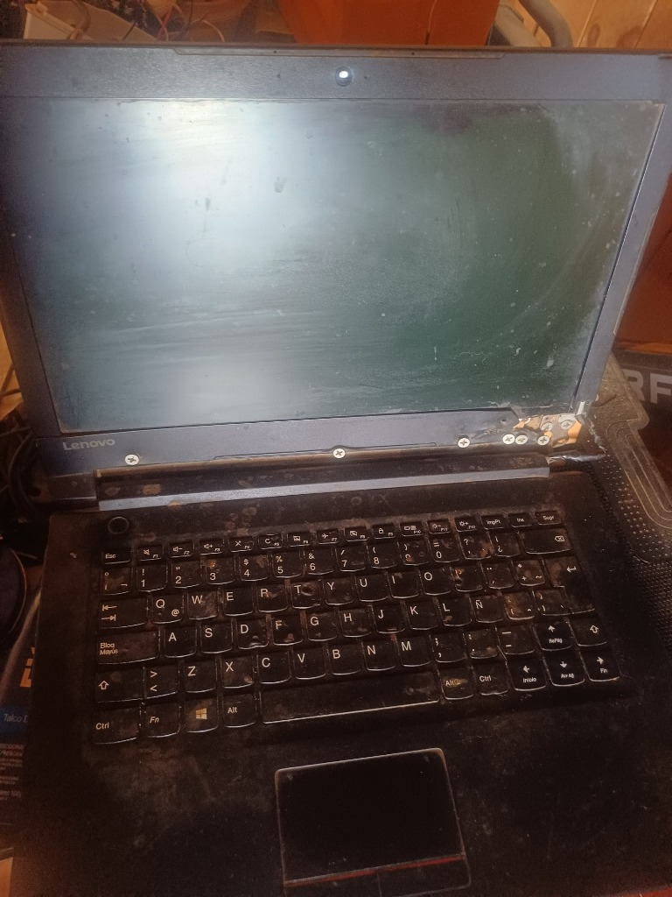
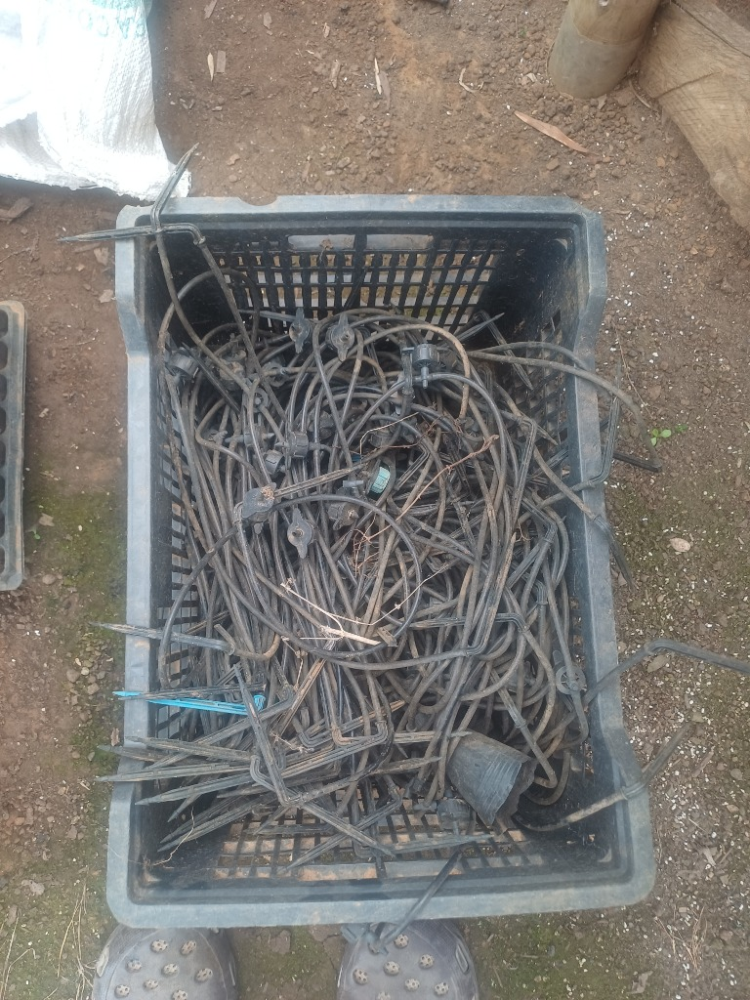
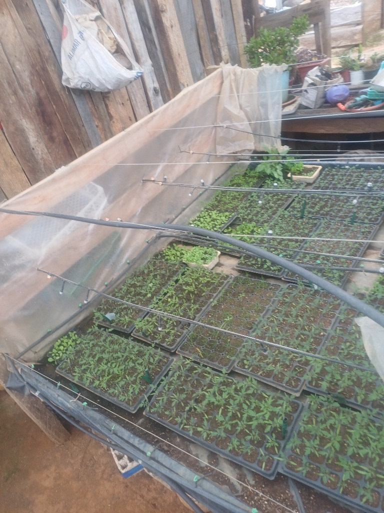
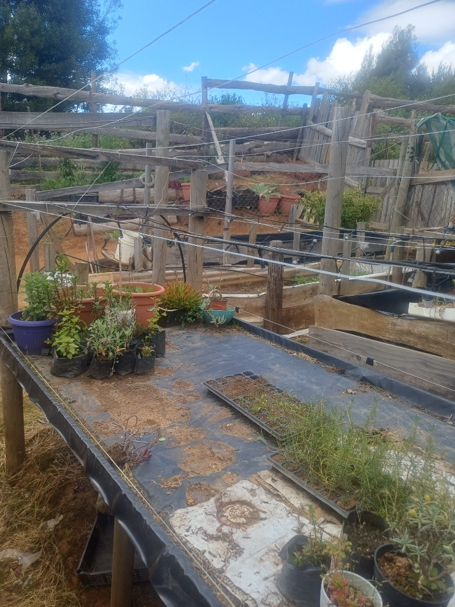
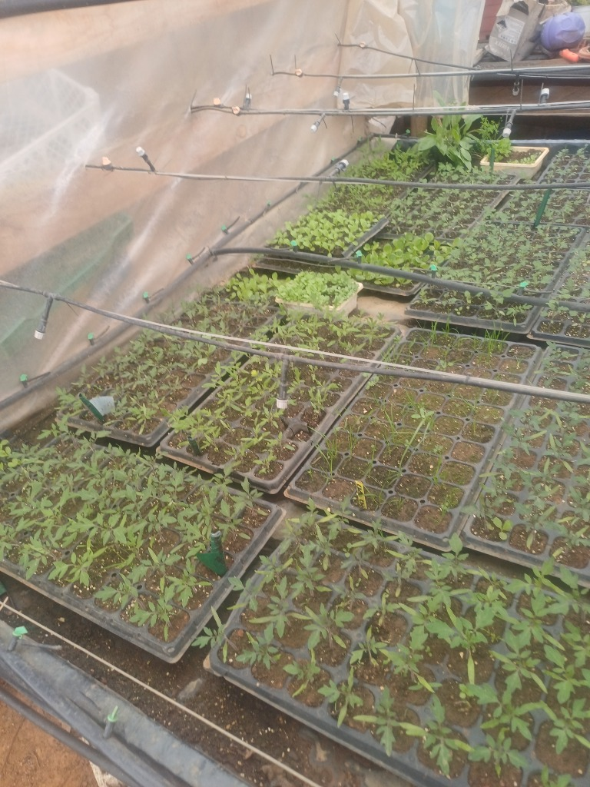
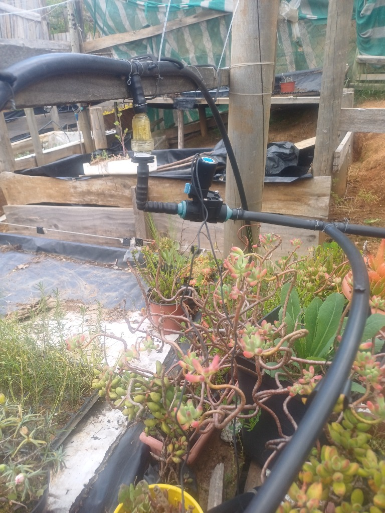
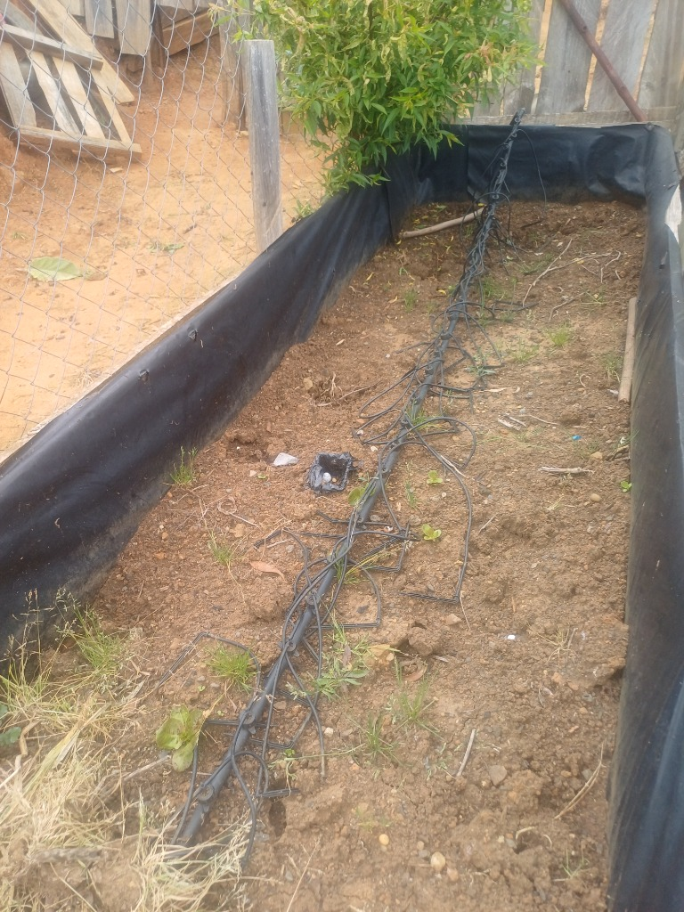
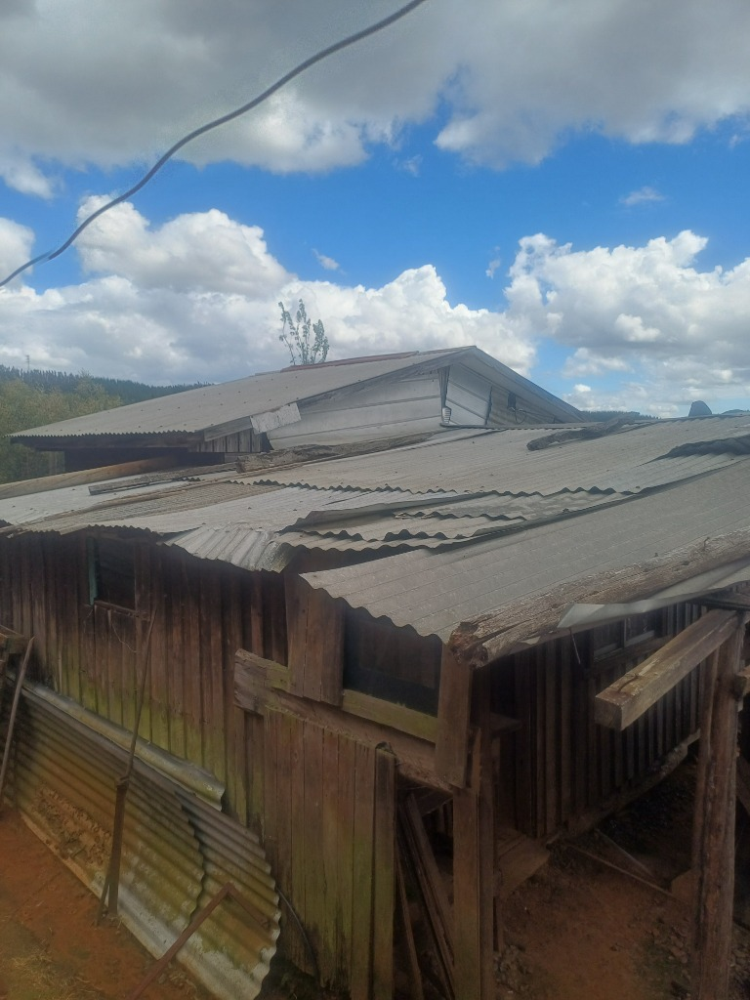

# 🌿 Connecting the Dots: Ancestral Wisdom, Responsible Technology, and a Home for My Mother

> **[Read in English](#english-version) | [Leer en Español](#version-en-español)**

---

## 🌐 English Version

> **A Note of Complete Transparency:**  
> I want to be honest from the very beginning: the phrasing and structure of this text were assisted by an Artificial Intelligence, because my condition on the autism spectrum makes it difficult for me to organize and express what I feel in writing. The AI lent me the words to order my thoughts, but **the heart, the story, the mistakes, the projects, and the honesty behind every single line are 100% mine and completely real.**

---

### 1. The Root: Indigenous Wisdom and "Connecting the Dots"
All my life, I have felt a deep fascination with the worldview of the indigenous peoples and ancestral shamans of our lands. They possess a unique gift for **connecting the dots**: they understand how the climate connects with the root, the lunar cycles with plant sap, and human health with medicinal herbs. For them, nothing is separated from Mother Earth.

That fascination has been the driving force of my entire life, leading me to a single fundamental question: **Why must modern technology be divorced from nature?**

With deep respect for all religions and worldviews, my conviction is that **responsible technology is not incompatible with Mother Earth.** Indigenous elders connect dots to protect life; we can use silicon, low-cost circuits, and open-source code not to exploit or gamble, but as a humble tool to listen to, understand, and accompany living things.

---

### 2. Who I Am and My Self-Taught Path
I come from the Global South, from an underprivileged background where nothing came easy. Because of my condition on the autism spectrum, conventional jobs, interviews, and corporate environments have always felt hostile and difficult to navigate.

However, that same mind gave me an unyielding curiosity and intense focus to learn on my own:
* In secondary school, I studied the fundamentals of basic electronics.
* I learned plant nutrition, hydroponics, and how to cultivate vegetables and medicinal herbs.
* I taught myself to program **ESP32** microcontrollers, wire IoT sensors, and design small solar-powered systems to automate irrigation.
* Recently, I began studying and experimenting with Artificial Intelligence.

---

### 3. The Scraps of Past Projects and the Stumble
If you walked into my home, you would not see a polished laboratory. You would see the real scraps of a self-taught builder without money: loose wires, microcontroller boards, half-assembled irrigation pipes, the hydroponics system I had to abandon years ago (though its knowledge of plant nutrition stayed in my head), and a small greenhouse with vegetable seedlings that I care for every morning.

My life has always followed the same cycle: I would learn something with passion, apply it with whatever materials I had, and when the money ran out, I was forced to set it aside and move to something else. Everything remained trapped inside my head as disconnected dots that I never had the resources to bring together.

In that constant desperation to move forward, seeing my mother age and feeling that money was never enough to finish anything, I made a very grave mistake: looking for a quick way out, I got involved in cryptocurrency trading, and **I lost the little I had.** It was a bitter, painful blow, but it left me with a permanent lesson: our salvation is not in financial casinos, but in returning to the soil and real honest work.

  
  

---

### 4. My Last Chance: The Bio-Connected Greenhouse
Today, I feel this is my last chance to **connect all the dots of my life before I grow older**:
* Ancestral respect for the earth and medicinal herbs.
* Plant nutrition and vegetable cultivation.
* Low-cost electronics (ESP32) and solar energy.
* And now, Artificial Intelligence as a bridge to interpret the subtle signals of soil moisture, light, and crop needs using affordable materials accessible to anyone.

I do not promise overnight miracles. I will move **step by step**, documenting everything under an Open Source license so anyone in rural or urban communities can replicate it, uploading real photos of my seedlings, my circuits, and my progress as time and energy permit.

#### 📸 Real Progress & Field Photos

  
  

  
  

  

---

### 5. The Physical Base: A Productive Homestead and a Roof for My Mother
Technology cannot be built without a dry, secure space to work. In the Global South, the greenhouse and the home are not separated: **they are on the exact same ground where we live.**

  

My mother has worked hard all her life under difficult conditions, and she is very tired. Seeing her daily exhaustion weighs heavily on my heart. We need a dignified space where she can rest in peace and where I can keep my workbench, my seedlings, and my circuit boards protected from the rain and weather.

Therefore, every donation received to my wallet will be allocated with complete transparency to these two inseparable pillars:

1. **Basic Physical Shelter (50%):** Bricks, cement, roofing, and building materials to secure the family homestead/workshop where my mother can live with dignity and where this project will be housed.
2. **Bio-Greenhouse Development (50%):** Purchasing affordable electronic components (soil moisture sensors, ESP32 boards, relays, small solar panels, irrigation tubing) to rebuild the greenhouse step-by-step and share all code and schematics openly with the public.

---

### 6. Transparency and Wallet
* **Giveth Campaign:** [Support KuifiMapu on Giveth.io](https://giveth.io/project/kuifimapu:-ancestral-wisdom-low-cost-iot-a-home-for)
* **Public Wallet Address (Polygon PoS / EVM):** `0x2821d6003ceE245C4997Ff908029aa0116177b69`
* **Preferred Network:** Polygon (low gas fees, accepts POL, USDC, DAI).

To anyone who feels in their heart to support a self-taught builder from the Global South seeking to connect the dots of his life, honor Mother Earth with conscious technology, and provide a secure roof for his mother: **thank you from the bottom of my heart for giving me the chance not to give up.**

---

 

---

## 🇪🇸 Versión en Español

> **Nota de total transparencia:**  
> Quiero ser sincero desde el inicio: la redacción y el orden de este texto los hice con la ayuda de una Inteligencia Artificial, porque por mi condición dentro del espectro autista me cuesta mucho estructurar y expresar lo que siento por escrito. La IA me prestó las palabras para ordenar mis ideas, pero **el fondo, la historia, los errores, los proyectos y la honestidad detrás de cada línea son 100% míos y completamente reales.**

---

### 1. La raíz: La fascinación por los pueblos originarios y el "unir los puntos"
Toda mi vida he tenido una profunda fascinación por la cosmovisión de los pueblos originarios y los chamanes de nuestras tierras. Ellos tienen una capacidad única para **unir los puntos**: entienden cómo se conecta el clima con la raíz, el ciclo de la luna con la savia de las plantas, y la salud del cuerpo con las hierbas medicinales. Para ellos, nada está separado de la Madre Tierra.

Esa fascinación es el motor que me ha llevado toda la vida a hacerme una sola pregunta: **¿Por qué la tecnología moderna tiene que estar divorciada de la naturaleza?** 

Con el debido respeto por todas las religiones y formas de ver el mundo, mi convicción es que **la tecnología responsable no es incompatible con la Madre Tierra.** Los pueblos ancestrales unen puntos para cuidar la vida; nosotros podemos usar el silicio, los circuitos y el código abierto no para destruir ni especular, sino como una herramienta humilde para escuchar, entender y acompañar el crecimiento de lo vivo.

---

### 2. Quién soy y mi camino autodidacta
Vengo del Sur Global, de un entorno sin facilidades económicas. Por mi condición dentro del espectro autista, el mundo de los empleos tradicionales y las oficinas siempre me resultó hostil y ajeno. Pero esa misma mente me dio una curiosidad incansable y una gran capacidad de concentración para aprender por mi propia cuenta:

* En la secundaria aprendí las bases de la electrónica.
* Aprendí sobre nutrición vegetal, hidroponía y el cultivo de hortalizas y plantas medicinales.
* Aprendí a programar microcontroladores **ESP32**, armar sensores IoT y circuitos de energía solar para automatizar el riego.
* Y recientemente, comencé a estudiar y experimentar con la Inteligencia Artificial.

---

### 3. Los restos del camino y el tropiezo
En mi casa no hay un laboratorio perfecto. Lo que hay son los restos reales de años de esfuerzo autodidacta: cables sueltos, placas electrónicas, caños de riego a medio armar, la hidroponía que dejé hace años pero cuyo conocimiento de nutrición me quedó grabado, y un pequeño invernadero con plantines que cuido todos los días.

Mi vida siempre fue el mismo ciclo: aprendía algo, lo aplicaba con pasión, y cuando se me acababa el dinero tenía que abandonarlo y pasar a otra cosa. Todo quedaba en mi cabeza, acumulado como puntos sueltos que nunca lograba conectar.

En esa desesperación constante por no poder concretar nada y viendo a mi madre envejecer, cometí un error muy grave: buscando una salida rápida para conseguir dinero, me metí en el trading de criptomonedas y **perdí lo poco que tenía.** Fue un golpe amargo que me dolió en el alma, pero me dejó una lección definitiva: la salvación no está en el casino financiero, sino en volver a la tierra y al trabajo real.

  
  

---

### 4. Mi última oportunidad: El Invernadero Bio-Conectado
Hoy siento que esta es mi última oportunidad para **unir todos los puntos de mi vida antes de hacerme más viejo**:
* La sabiduría ancestral de respeto a la tierra.
* La nutrición de las plantas y el cultivo de alimentos.
* La electrónica de bajo costo (ESP32) y la energía solar.
* Y la Inteligencia Artificial como puente para interpretar las señales sutiles de la humedad, la luz y las necesidades de los cultivos con materiales económicos y accesibles para cualquiera.

No prometo cosas milagrosas de un día para el otro. Voy a ir **paso a paso**, documentando todo de forma abierta (Open Source) para que cualquier persona del campo o la ciudad pueda replicarlo, y subiendo fotos reales de mis plantines, de mis circuitos y de mis avances a medida que el tiempo y las fuerzas me lo permitan.

#### 📸 Fotografías del avance real y el terreno

  
  

  
  

  

---

### 5. La base física: Vivienda productiva, taller y un techo para mi madre
No se puede hacer tecnología si no hay un lugar seco y seguro donde trabajar. En el Sur Global, el invernadero y la casa no están separados: **están en el mismo terreno donde vivimos.**

  

Mi madre ha trabajado toda su vida en condiciones duras y ya está muy cansada. Ver su desgaste diario es lo que me aprieta el pecho. Necesitamos un espacio digno donde ella pueda descansar en paz y donde yo pueda tener mi banco de trabajo, mis plantas y mis placas a salvo de las lluvias y la intemperie.

Por eso, cada donación o ayuda que reciba a mi billetera se destinará con total transparencia a estos dos pilares inseparables:

1. **La infraestructura básica del espacio (50%):** Ladrillos, cemento, techo y materiales para levantar la vivienda-taller familiar donde mi madre pueda vivir dignamente y donde funcionará el espacio de trabajo.
2. **El desarrollo del invernadero IoT + IA (50%):** Adquisición de componentes electrónicos accesibles (sensores de suelo, microcontroladores ESP32, relés, pequeños paneles solares y caños de riego) para reactivar el invernadero y compartir todos los códigos y esquemas de forma libre y pública.

---

### 6. Transparencia y Contacto
* **Campaña Oficial en Giveth:** [Apoyar a KuifiMapu en Giveth.io](https://giveth.io/project/kuifimapu:-ancestral-wisdom-low-cost-iot-a-home-for)
* **Dirección de Billetera (Polygon PoS / EVM):** `0x2821d6003ceE245C4997Ff908029aa0116177b69`
* **Red preferida:** Polygon (bajas comisiones en POL, USDC o DAI).

A quienes sientan en el corazón apoyar a un autodidacta del Sur Global que solo busca unir los puntos de su vida, respetar a la Madre Tierra con tecnología consciente y darle un techo seguro a su madre: **gracias infinitas por darme la oportunidad de no rendirme.**
